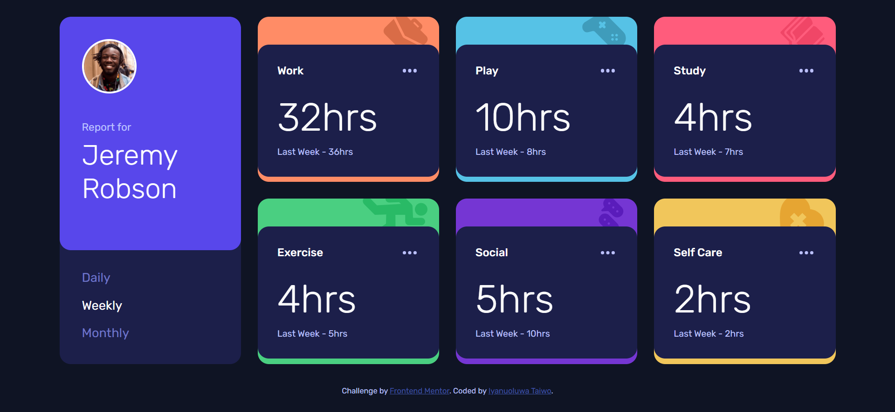

# Frontend Mentor - Time tracking dashboard solution

This is my solution to the [Time tracking dashboard challenge on Frontend Mentor](https://www.frontendmentor.io/challenges/time-tracking-dashboard-UIQ7167Jw).

## Table of contents

- [Overview](#overview)
  - [The challenge](#the-challenge)
  - [Screenshot](#screenshot)
  - [Links](#links)
- [My process](#my-process)
  - [Built with](#built-with)
  - [What I learned](#what-i-learned)
  - [Continued development](#continued-development)
  - [AI Collaboration](#ai-collaboration)
- [Author](#author)

## Overview

### The challenge

Users should be able to:

- View the optimal layout for the dashboard depending on their device's screen size
- See hover states for all interactive elements on the page
- Switch between viewing Daily, Weekly, and Monthly stats

### Screenshot



### Links

- Solution URL: [Add solution URL here](https://your-solution-url.com)
- Live Site URL: [Add live site URL here](https://your-live-site-url.com)

## My process

### Built with

- Semantic HTML5 markup
- Sass (SCSS) with variables and nesting
- CSS Grid and Flexbox
- Mobile-first workflow
- Vanilla JavaScript (no frameworks)

### What I learned

**1. Grid placement controls the layout.** The tall profile card on desktop and the full-width one on tablet both come from placing a single item on the grid:

```scss
.profile { grid-row: 1 / span 2; }   // desktop: spans two rows
.profile { grid-column: 1 / -1; }    // tablet: spans every column
```

Using `-1` means "the last line", so the card still fills the width if the column count changes.

**2. Sass nesting must mirror the HTML.** A nested selector only matches elements nested the same way in the markup. Putting `.timeframes` inside `.profile-header` in the SCSS silently matched nothing, because in the HTML the two are siblings. Reading the compiled CSS is the fastest way to spot this.

**3. Sass variables don't exist at runtime.** `var(--accent)` is a CSS custom property, while `$work` is a Sass variable that disappears at compile time. To give a custom property a Sass value, it has to be interpolated:

```scss
.work { --accent: #{$work}; }
```

**4. Build repeated markup from data.** The six activity cards are generated once from an array, and switching timeframe only updates their text:

```js
function render(timeframe) {
  activities.forEach((a) => {
    const { current, previous } = a.timeframes[timeframe];
    a.el.querySelector(".current").textContent = hrs(current);
    a.el.querySelector(".previous").textContent =
      `${previousLabel[timeframe]} - ${hrs(previous)}`;
  });
}
```

**5. `min-width` media queries stack.** Anything set at the tablet breakpoint is still active at desktop, so a value like `grid-column: 1 / -1` has to be explicitly reset (`grid-column: auto`) when the layout changes again.

### Continued development

- Fetch the stats from `data.json` instead of hard-coding them in the script
- Persist the selected timeframe (for example in `localStorage`)
- Practice reading compiled output and dev tools earlier when a style does not apply

### AI Collaboration

I used Claude to help debug this project. It was most useful for pointing out why styles weren't applying (mismatched Sass nesting, reversed breakpoints, undefined custom properties) and explaining the reasoning behind each fix, which I then applied and tested myself. It was less useful when I pasted code without describing what I expected to see, since the answer depended on knowing the intended result.

## Author

- Frontend Mentor - [@Iyanu22](https://www.frontendmentor.io/profile/Iyanu22)
- Website - Iyanuoluwa Taiwo